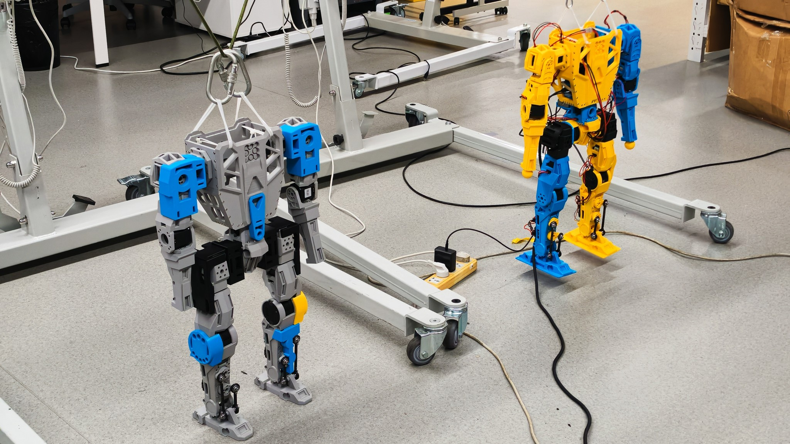
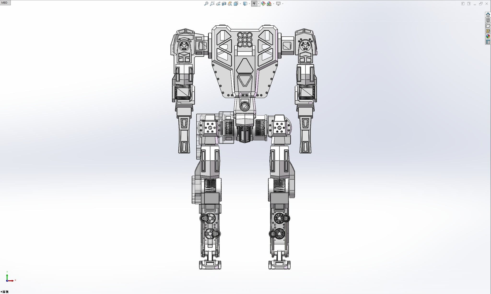
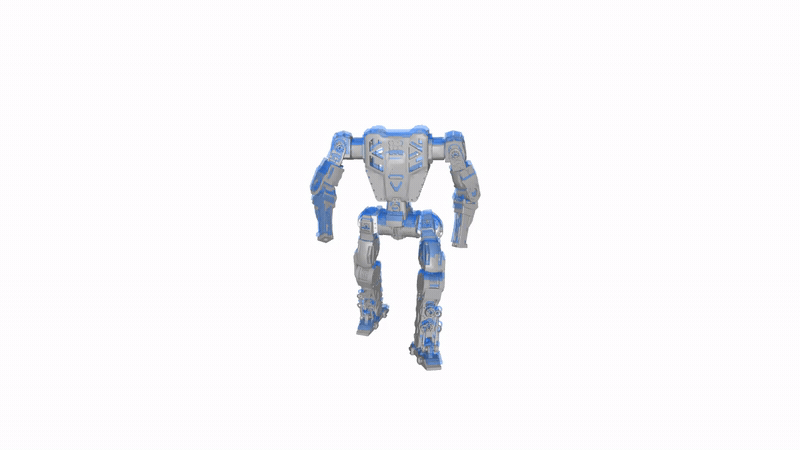
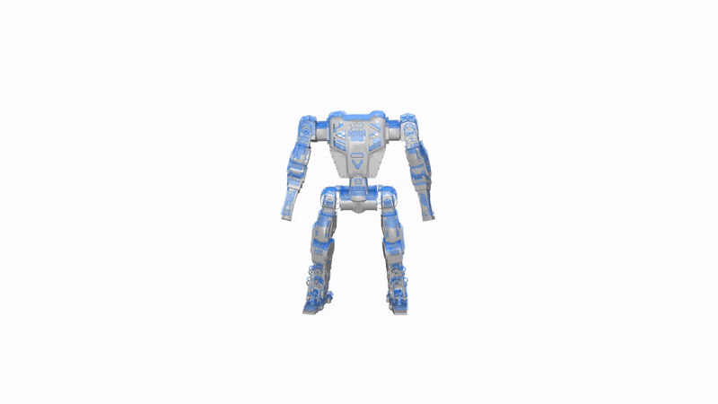
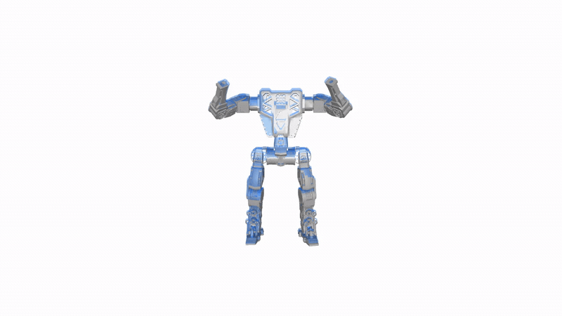
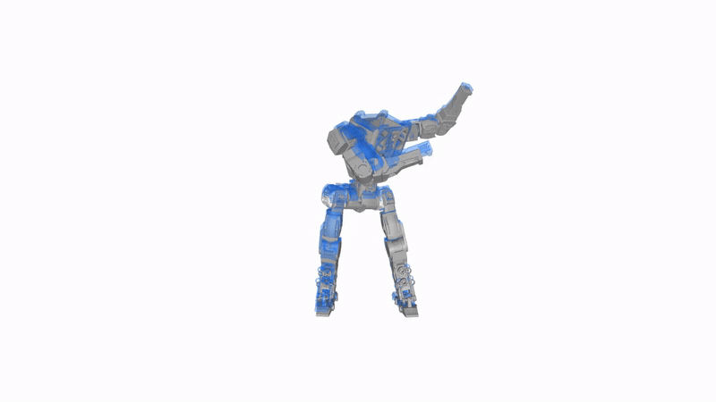
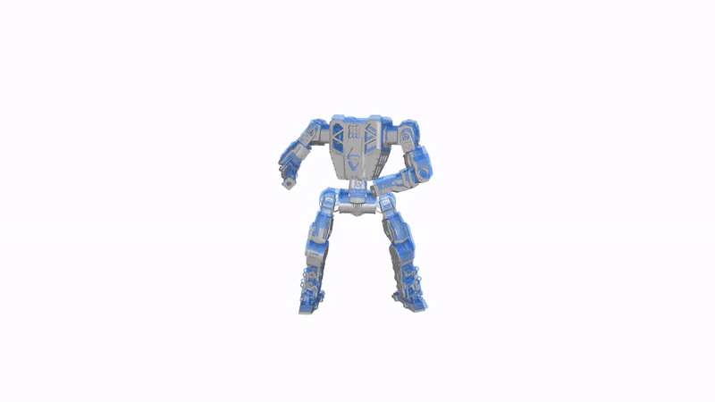
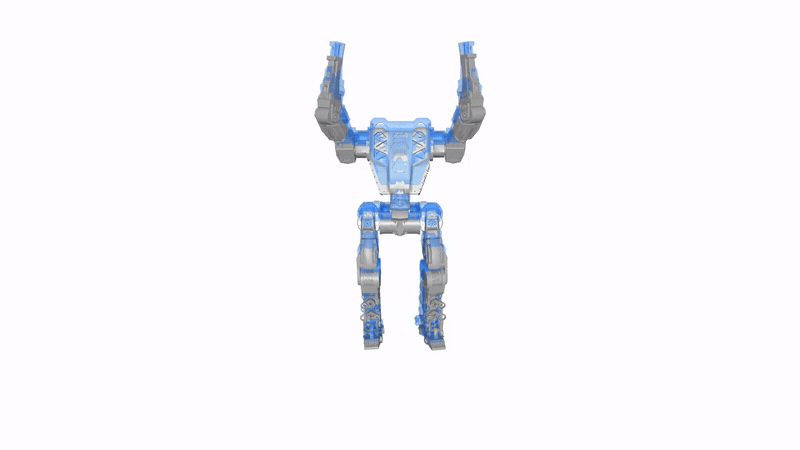
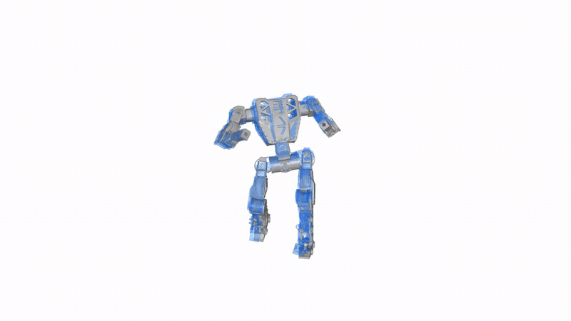

# ZerothRobot:RoboRigo

[**English**](README.md) | [Chinese](README.zh-CN.md)

**An open-source humanoid robot project for developers and makers.**

[](LICENSE)
[](https://www.python.org/)
[](https://github.com/ZerothRobot/roborigo)<br>
[](https://mujoco.org/)
[](https://github.com/google-deepmind/mujoco_warp)
[](https://isaac-sim.github.io/IsaacLab)
[](https://github.com/ZerothRobot/roborigo-description)<br>
[](https://github.com/ZerothRobot/roborigo-retarget)
[](https://github.com/ZerothRobot/roborigo-rl-mjlab)
[](https://github.com/ZerothRobot/roborigo-deploy)
[](https://github.com/ZerothRobot/roborigo-hardware)

<div align="center">
  
  
</div>

## About

RoboRigo is a fully open-source, 3D-printed humanoid robot with **21 degrees of freedom** and modular actuators. It aims to make hands-on humanoid robotics research more accessible to developers and makers:

- **Printable** — Structural components can be made with a standard FDM 3D printer.
- **Replicable** — The complete bill of materials, assembly guide, and calibration procedure are open source.
- **Trainable** — Reinforcement learning workflows support multiple simulation backends.
- **Deployable** — Trained policies can be exported for use on the physical robot.
- **Extensible** — Designed to work with widely used and emerging robotics frameworks.

---

## Demos



Walking motion. The solid gray robot shows the policy output, and the blue translucent figure shows the reference motion.

### PartyMimic dance demos

<table>
  <tr>
    <td align="center"><br>Best Mates</td>
    <td align="center"><br>Chicken Dance</td>
  </tr>
  <tr>
    <td align="center"><br>Robot Dance</td>
    <td align="center"><br>Macarena</td>
  </tr>
  <tr>
    <td align="center"><br>YMCA</td>
    <td align="center"><br>Salsa</td>
  </tr>
</table>

---

## Repositories

RoboRigo consists of several independent repositories. This repository ([roborigo](https://github.com/ZerothRobot/roborigo)) is the documentation and repository index. Implementation lives in the component repositories. **There is no unified command entry point here.** Run commands from the relevant component repository.

| Repository | Responsibility | Dependencies / entry points |
|---|---|---|
| **[roborigo-description](https://github.com/ZerothRobot/roborigo-description)** | **Authoritative robot description**<br>URDF / MJCF / meshes / joint definitions / actuator parameters | — |
| **[roborigo-retarget](https://github.com/ZerothRobot/roborigo-retarget)** | Human-to-robot motion retargeting pipeline | description |
| **[roborigo-rl-mjlab](https://github.com/ZerothRobot/roborigo-rl-mjlab)** | RL training backend A (mjlab + MuJoCo Warp) | description, retarget |
| **[roborigo-rl-isaaclab](https://github.com/ZerothRobot/roborigo-rl-isaaclab)** | RL training backend B (Isaac Lab) | description, retarget |
| **[roborigo-deploy](https://github.com/ZerothRobot/roborigo-deploy)** | Policy deployment and on-robot inference | description |
| **[roborigo-hardware](https://github.com/ZerothRobot/roborigo-hardware)** | Mechanical design / electronics / PCB / bill of materials | — |
| **[roborigo-appearance](https://github.com/ZerothRobot/roborigo-appearance)** | Enclosures and DIY tools | hardware |
| **[roborigo-navigation](https://github.com/ZerothRobot/roborigo-navigation)** | Navigation and localization examples | description |
| **[roborigo-PartyMimic](https://github.com/ZerothRobot/roborigo-PartyMimic)** | PartyMimic motion-tracking training, evaluation, and RoboRigo baseline | description, retarget |
| **[roborigo-supermimic](https://github.com/ZerothRobot/roborigo-supermimic)** | SuperMimic reproduction and RoboRigo transfer experiments | description, retarget |
| **[roborigo-xmimic](https://github.com/ZerothRobot/roborigo-xmimic)** | XMimic whole-body motion-tracking research and reproduction | — |
| **[roborigo-web](https://github.com/ZerothRobot/roborigo-web)** | Website, documentation, and browser simulation; [online simulator](https://huggingface.co/spaces/ZerothRobot/ZerothRobot-simulator) | description |
| **[roborigo-pipeline](https://github.com/ZerothRobot/roborigo-pipeline)** | Development pipeline / packaging / distribution | all |

### Dependency map

```
                    roborigo-description   ★ authoritative source
                            │
        ┌───────────────────┼───────────────────┬──────────────────┐
        ▼                   ▼                   ▼                  ▼
  roborigo-retarget     roborigo-rl-mjlab  roborigo-rl-isaaclab  roborigo-deploy
  (motion retargeting)  (backend A)        (backend B)           (on-robot policy)
        │                   │                   │                  │
        └───────────────────┴───────────────────┴──────────────────┘
                            ▼
               roborigo (documentation / repository index)
```

**Key design principle:** All four consumers follow the joint order and actuator parameters defined by `roborigo-description`.

---

## Quick start

The component repositories are checked out as sibling directories (the current setup does not use Git submodules):

```
<workspace>/
├── roborigo/                  ← documentation / repository index
├── roborigo-description/
├── roborigo-retarget/
├── roborigo-rl-mjlab/
├── roborigo-rl-isaaclab/
├── roborigo-deploy/
├── roborigo-hardware/
├── roborigo-appearance/
├── roborigo-navigation/
├── roborigo-PartyMimic/
├── roborigo-supermimic/
├── roborigo-xmimic/
├── roborigo-web/
└── roborigo-pipeline/
```

Install dependencies and run commands inside the relevant repository. The following example trains and replays a velocity-tracking policy with backend A:

```bash
conda activate roborigo_mjlab
cd roborigo-rl-mjlab

# Train a velocity-tracking policy
python scripts/train.py RoboRigo-Flat

# Replay with the reference motion only
python scripts/play.py RoboRigo-Flat --agent zero
```

> Refer to each component repository's README for its commands. This repository does not provide a unified command such as `make` or `uv run`.

---

## Documentation

| Document | Contents |
|---|---|
| [`docs/architecture.md`](docs/architecture.md) | System architecture and data flow |
| [`docs/naming.md`](docs/naming.md) | Naming conventions |

---

## Contributing

RoboRigo is built by the community. Before contributing, please read:

- [`THIRD_PARTY_NOTICES.md`](THIRD_PARTY_NOTICES.md) — third-party components and their licenses

**For issues and code contributions related to a specific module, use its component repository.** Issues and pull requests in this repository are for the documentation and repository index, repository links and metadata, and cross-repository CI, packaging, distribution, and snapshots. The cross-repository pipeline is maintained in [`roborigo-pipeline`](https://github.com/ZerothRobot/roborigo-pipeline).

---

## License

This project is licensed under the [Apache License 2.0](LICENSE).

See [`THIRD_PARTY_NOTICES.md`](THIRD_PARTY_NOTICES.md) for third-party components and their licenses.
